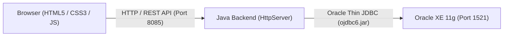

# Bank Loan Management System

[](https://www.oracle.com/java/)
[](https://www.oracle.com/database/)
[](https://www.oracle.com/database/technologies/appdev/jdbc.html)
[](https://developer.mozilla.org/)
[]()

A lightweight, full-stack bank loan processing application and DBMS demonstration built for the college **DBMS PAT-4** practical. It integrates a native Java HTTP backend with an Oracle 11g Express Edition database to provide role-based authentication, loan application workflows, automated credit eligibility estimation, and interactive SQL demonstrations.

---

## Choose How to Run

### Option 1: Live Demo (Recommended)

> **Live URL:** [https://courts-advertisement-crafts-effective.trycloudflare.com](https://courts-advertisement-crafts-effective.trycloudflare.com)

**Demo Credentials:**
- **Administrator:** `admin` / `admin123`
- **Loan Officer:** `officer1` / `officer123`

> [!NOTE]
> *This is a temporary public demo connected to the host laptop. The host laptop, Oracle XE database, Java backend, and Cloudflare Tunnel must remain running for the link to be reachable.*

---

### Option 2: Run Locally

1. **Prerequisites:** Install Java 21 (or 17+) and Oracle Database 11g Express Edition.
2. **Configure Database:** Copy `db.properties.example` to `config/db.properties` and update with your local Oracle port, username, and password.
3. **Initialize Schema:** For a fresh database, execute `sql/01_schema.sql` and `sql/02_sample_data.sql` in your Oracle XE account.
4. **Compile & Start:**
   ```cmd
   .\compile.bat
   .\run.bat
   ```
5. **Access Application:** Open [http://localhost:8085](http://localhost:8085) in your web browser.

---

## Tech Stack

| Layer | Technologies |
| :--- | :--- |
| **Frontend** | HTML5 · CSS3 · Vanilla JavaScript (SPA, Fetch API) |
| **Backend** | Java 21 OpenJDK (`com.sun.net.httpserver.HttpServer` on port `8085`) |
| **Database** | Oracle Database 11g Express Edition (XE) |
| **Connectivity** | Oracle JDBC Thin Driver (`ojdbc6.jar`) · Windows ODBC (`OracleXE_PAT4`) |
| **Tooling & VCS** | Git · GitHub · Batch Scripts (`compile.bat`, `run.bat`, `public_url.bat`) |

---

## Key Features

- **Role-Based Authentication:** Secure login for Administrator and Loan Officer accounts using salted SHA-256 password hashing.
- **Interactive Dashboard:** Real-time metrics showing total applications, volume, and approval breakdowns retrieved directly from Oracle.
- **Loan Application Processing:** Complete workflow to create, view, search, review, and approve or reject applicant files.
- **Eligibility & EMI Calculator:** Automated Debt-to-Income (DTI) ratio evaluation and loan eligibility calculation engine.
- **Live SQL Demonstrations:** Interactive web console to run live DDL (`CREATE`/`ALTER`), DML (`INSERT`/`UPDATE`/`DELETE`), and DQL (multi-table relational joins).
- **Database Connectivity Checks:** Independent status diagnostic buttons for Oracle JDBC connectivity and Windows 64-bit ODBC DSN.

---

## Database

### Relational Tables (8)
`USERS` · `CUSTOMERS` · `EMPLOYMENT_DETAILS` · `FINANCIAL_DETAILS` · `LOAN_TYPES` · `LOAN_APPLICATIONS` · `LOAN_DOCUMENTS` · `LOAN_REPAYMENTS`

### Architecture


---

## Repositories

- **Personal Repository:** [https://github.com/arushigrover07/Bank_Loan-Management-System](https://github.com/arushigrover07/Bank_Loan-Management-System)
- **Submission Repository:** [https://github.com/arushigrover07/BankLoanManagementSystem_25BCE1190](https://github.com/arushigrover07/BankLoanManagementSystem_25BCE1190)
